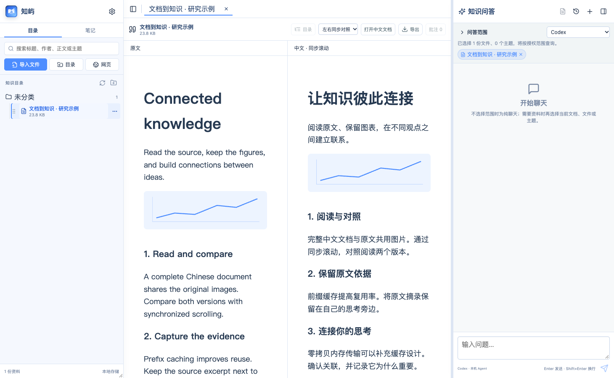
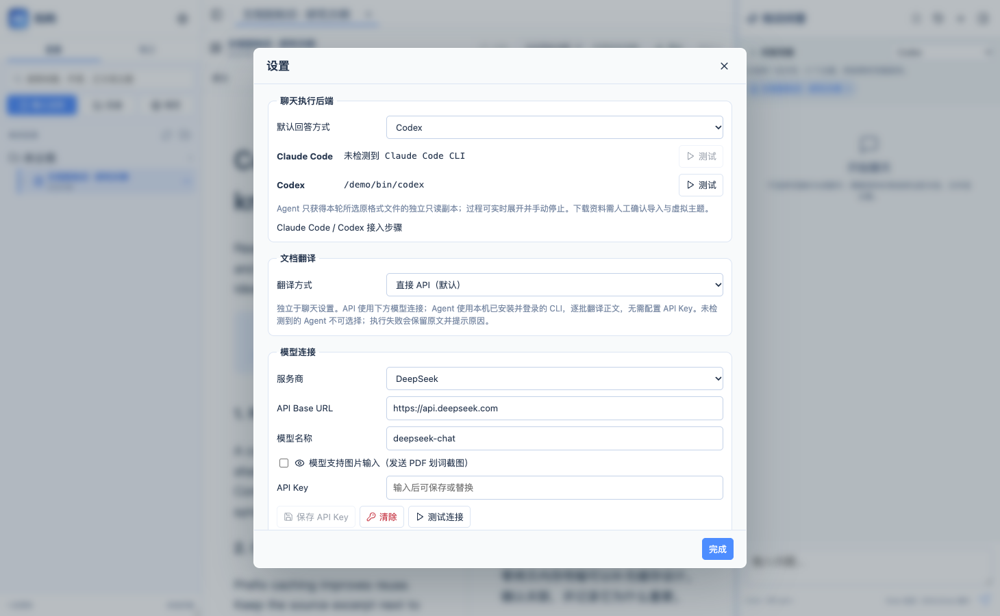
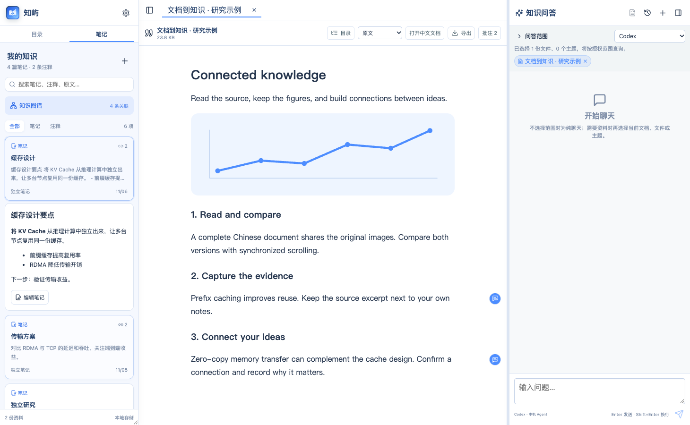
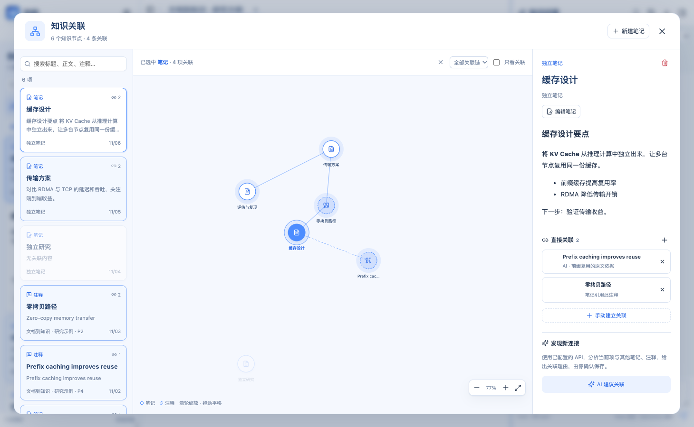

# Zhiyu KnowledgeMaster

[简体中文](README.md) | [English](README.en.md)

> A local-first knowledge workspace for reading and studying research papers, built for both macOS and Windows with Tauri.

KnowledgeMaster brings paper collection, close reading and annotation, research notes, multi-document Q&A, and knowledge synthesis into one desktop application. Your documents and metadata stay on your own disk by default. AI can access only the scope you explicitly authorize, and only when you initiate a request.

> v0.3.0 includes full-document translation, the knowledge graph, and the blue theme. Download a portable ZIP for macOS Apple Silicon or a portable EXE / ZIP for Windows x64 from [Releases](https://github.com/hkcao/KnowledgeMaster/releases).

## Interface Tour

These screenshots show the current Chinese-language UI with synthetic documents and notes. Translations are demonstration content, with no private data.

### Bilingual reading with shared images

Choose full Chinese translation during import or translate an existing document from the reader. The original and the separate Chinese document share image resources. Switch between alternating paragraphs and parallel panes with paragraph-based synchronized scrolling.



### Choose the translation backend independently

In Settings, choose direct API (default) or a detected Claude Code / Codex CLI for translation, independently from chat. Search covers both languages and opens the original; the directory lists one article.



### Click a note to expand only that item

Search notes and annotations directly. Clicking a card expands its content, source excerpt, and editing actions in the list; clicking again collapses it. The current document stays open, and the graph does not open automatically.



### Open the knowledge graph through its own button

Only the Knowledge Graph button opens the relationship workspace. Selecting a note or annotation highlights its connected chain or direct neighbors. Create or remove links manually, or ask the configured model for suggestions with explanations and confirm the ones to save.



## Quick Start

1. **Import** files, folders, or web pages and optionally translate them into Chinese. Download the local OCR models in Settings for scanned PDFs.
2. **Read and capture** the original or bilingual document, annotate selected text, and save your thoughts as Markdown notes.
3. **Search and expand** items in the Notes tab to read their full content and source excerpts.
4. **Connect and ask** through the separate knowledge graph and Agent chat. Agent mode includes the current document by default; clear it or add other documents and topics as needed.

## Features

### Research Library

- Import files with a file picker, recursive folder scan, drag and drop, or a URL.
- Read PDF, HTML, Markdown, TXT, DOC, and DOCX files.
- Deduplicate imports by both filename and SHA-256; original files are stored in a flat directory.
- Prefer the paper naming format `First Author et al., Paper Title` when metadata can be recognized.
- Organize documents in hierarchical virtual topics; one document can belong to multiple topics.
- Recommend topics locally after import and create associations only after user confirmation.
- Search titles, authors, topics, and full text with keywords, without a vector database.
- Choose the library location. Placing it in iCloud Drive, OneDrive, or another synced directory delegates synchronization to the operating system.

### Reading, Annotation, and Notes

- Continuous PDF.js reader with selectable text, trackpad or wheel zoom, bookmarks, and document outline navigation.
- Read-only HTML, Markdown, and plain-text previews; Markdown supports GFM and LaTeX.
- Multi-tab reading. Hiding or restoring either sidebar keeps the current document and page.
- Select text in PDFs or text documents to open nearby Ask AI, quote, highlight, underline, and note actions.
- Selected-region AI context includes extracted source text and, when multimodal input is enabled, a screenshot of the selected region.
- Annotation markers stay in the page margin. Click a highlighted or underlined region to edit its note or delete the annotation.
- Summary notes are stored as Markdown files and can reference multiple source annotations.
- Notes and annotations appear as searchable cards. Search titles, content, original excerpts, and source document names, then click a card to expand only that item for reading and editing. The knowledge graph opens only through its dedicated button.
- Connect any pair of notes or annotations in a zoomable, pannable knowledge graph. Existing annotation references appear automatically. Selecting a node highlights its entire connected chain or just direct neighbors.
- The configured API can suggest connections with explanations; suggestions are saved only after confirmation. For larger libraries, analysis uses the 40 most relevant candidates and displays its scope.
- Export either the original document or a copy with annotations.
- Optionally translate full documents into Chinese when importing files, folders, dropped files, or web pages, using an independently configured translation backend: direct API by default, or a detected and authenticated Claude Code / Codex CLI. Existing documents have a Translate action. Originals are retained and a searchable Chinese HTML document shares the library's image resources. Search covers both languages and merges matches into the original; the directory lists only originals. A retained translation becomes visible independently if its original is deleted.
- Read alternating source/Chinese paragraphs or parallel panes with paragraph-based synchronized scrolling. Text PDFs retain page graphics and text positions; scanned pages retain the scan with translated OCR below it. DOCX preserves paragraphs, tables, and embedded images; complex Word pagination and floating layouts may differ. Convert DOC to DOCX/PDF first. Code and formulas stay unchanged.

### AI and Local Agents

- Direct API mode supports DeepSeek, Zhipu GLM, and custom OpenAI-compatible endpoints.
- API mode can use either relevant text snippets or autonomous retrieval with file tools.
- Connect to locally installed Claude Code and Codex CLIs, inspect their collapsible execution logs, and stop a running task manually.
- Select multiple documents or topics as the Q&A scope. Agent mode creates an isolated temporary workspace for that scope.
- Agents receive read-only copies of original files and can reuse existing PDF, OCR, or parsing caches instead of relying on pre-chunked text.
- Activating an Agent or starting a new Agent conversation selects the currently displayed document by default. The selection follows the current tab and can be cleared in the scope picker or document chip.
- Chat loads no local context when there is no quote, selected document/topic, or automatically included current document. Direct API mode starts with an empty scope.
- Files downloaded by an Agent enter a pending-import area. The user confirms both the import and its virtual topics.
- Preserve conversation history and generate incremental Markdown summaries.

### Local-First Storage and Safety

- Documents, topics, search text, annotations, notes, and conversations live in the selected local library.
- API keys are stored in macOS Keychain or Windows Credential Manager.
- Starting the app, opening Settings, or switching providers does not read a key. Keys are accessed only when sending a request or testing a connection.
- Agents can write only inside isolated workspaces; source copies and parsing caches are read-only.
- Metadata uses indexed SQLite tables with foreign keys. A legacy `knowledge.json` library is migrated on first launch, and a migration backup that the app no longer updates is retained.
- The frontend has no arbitrary filesystem access; all file operations go through validated Rust commands.

## Platforms and Technology

| Item | macOS | Windows |
|---|---|---|
| Minimum target | macOS 14+ | Windows 10/11 |
| WebView | System WebKit | WebView2 |
| Credentials | Keychain | Credential Manager |
| Agent termination | Terminate the process | Terminate the process tree with `taskkill /T` |
| Release packages | Portable `.zip` / `.dmg` | Portable `.exe` / `.zip` / NSIS installer `.exe` |

Shared stack:

- Tauri 2
- React 19, TypeScript, and Vite
- Rust
- PDF.js
- React Markdown, GFM, and KaTeX

KnowledgeMaster does not use Electron, require a hosted application backend, or include embeddings or a vector database.

## Install and Get Started

### Windows

1. Download `KnowledgeMaster-portable.exe` from [GitHub Releases](https://github.com/hkcao/KnowledgeMaster/releases). It is a portable build: put it in a normal folder and double-click it to run.
2. To create Start menu shortcuts, download the NSIS package whose filename ends in `-setup.exe`. Do not download the macOS `.dmg` package.
3. The portable build requires WebView2. Recent Windows 10/11 installations normally include it. If the application does not start, install Microsoft Edge WebView2 Runtime first. The installer build can bootstrap a missing runtime over the network.
4. Unsigned releases may trigger Windows SmartScreen. Verify that the file came from this repository's Release page, then choose **More info > Run anyway**.
5. On first launch, choose a library directory in Settings. For cross-device synchronization, you may choose a OneDrive directory, but do not modify the same library from two computers at the same time.
6. Direct API features need a model connection and API key in Settings, stored in Windows Credential Manager and read on demand. Translation or chat through an authenticated Claude Code / Codex CLI does not require an application API key.

If a Release does not yet contain a Windows package, build it from source with the instructions below.

### macOS

Download `KnowledgeMaster-0.3.0-macOS-arm64-portable.zip` from [GitHub Releases](https://github.com/hkcao/KnowledgeMaster/releases), unzip it, and open the app directly. A `.dmg` is also available to drag KnowledgeMaster into Applications. Because current builds are not Apple-notarized, macOS may require approval under **System Settings > Privacy & Security** the first time you open the app.

### Local CPU OCR (v0.2.8 and later)

In **Settings > 本地 PDF OCR · MinerU**, download the OCR models and runtime. The app prepares an isolated Python environment, MinerU 4.0.12 and Basic ONNX models without requiring a Python installation or GPU. Models are approximately 0.8 GB; runtime dependencies and installation caches require additional space. Choose automatic model-source selection, ModelScope or Hugging Face. Setup can be cancelled and retried.

Automatic OCR is enabled by default. Text PDFs use native extraction first; parser failures fall back to full-document OCR, while sparse pages are recognized individually with original page numbers preserved. Until models are installed, native extraction remains available. Files requiring OCR remain in place for a later directory refresh. Individual failures do not stop the batch and are listed in the library. Existing empty PDF indexes are retried once OCR is ready.

Inference runs locally in a separate process using local models, without uploading documents. The runtime, models and OCR cache live in the application data directory shown in Settings, outside the installer and synchronized library. Cache keys include source hashes, engine version and page selection; extracted text uses the existing library index. Disable automatic OCR to use native extraction only. CPU speed depends on document length and layout; check complex formulas and tables against the original.

Local OCR uses [MinerU](https://github.com/opendatalab/MinerU) and [uv](https://github.com/astral-sh/uv), subject to their upstream and model licenses. KnowledgeMaster itself remains MIT-licensed.

## Build from Source

### Windows

Prepare a Windows 10/11 x64 environment with:

- [Node.js 22 LTS](https://nodejs.org/).
- [Rust stable](https://www.rust-lang.org/tools/install) with the default `x86_64-pc-windows-msvc` toolchain.
- [Microsoft C++ Build Tools](https://visualstudio.microsoft.com/visual-cpp-build-tools/) with **Desktop development with C++** and a Windows 10/11 SDK.
- Microsoft Edge WebView2 Runtime. Recent Windows 10/11 installations normally include it; otherwise install the Evergreen Runtime from [Microsoft WebView2](https://developer.microsoft.com/microsoft-edge/webview2/).

Run in PowerShell:

```powershell
git clone https://github.com/hkcao/KnowledgeMaster.git
cd KnowledgeMaster
npm ci
npm test
cargo test --manifest-path src-tauri/Cargo.toml
npm run tauri dev
```

Build the app and copy the raw executable as a portable package:

```powershell
npm run tauri build -- --bundles nsis
Copy-Item src-tauri\target\release\knowledge-master.exe KnowledgeMaster-portable.exe
```

The same build produces an NSIS installer:

```powershell
Get-ChildItem src-tauri\target\release\bundle\nsis\*-setup.exe
```

Windows packages should be built on Windows. The repository's GitHub Actions workflow validates both the portable executable and installer on a Windows runner. Pushing a `v*` tag attaches both `.exe` files to the matching GitHub Release.

### macOS

Install macOS 14+, Xcode Command Line Tools, Node.js 22 LTS, and Rust stable, then run:

```bash
git clone https://github.com/hkcao/KnowledgeMaster.git
cd KnowledgeMaster
npm ci
npm test
cargo test --manifest-path src-tauri/Cargo.toml
npm run tauri dev
```

Build the `.app` and `.dmg` packages:

```bash
npm run tauri build -- --bundles app,dmg
```

Build outputs are written to `src-tauri/target/release/bundle/macos/` and `src-tauri/target/release/bundle/dmg/`.

Production packages should be built on their target operating system. `.github/workflows/tauri-ci.yml` runs frontend and Rust tests on both macOS and Windows, builds a macOS `.dmg`, and produces Windows portable and NSIS packages.

## Local Library Layout

```text
<library>/
├── knowledge.db                   # SQLite metadata
├── knowledge.json.migrated-v8.bak # Created only during a legacy migration
├── index/assets/                  # HTML/Markdown image reference maps
└── source/
    ├── documents/                # Originals and separate Chinese documents
    ├── assets/                   # Images shared by originals and translations
    ├── downloads/pending/        # Agent downloads awaiting confirmation
    ├── generated/                # agent-cache/ parsing cache and chunks/ cache
    ├── index/                    # Extracted text and translations/ alignment
    └── notes/                    # Markdown notes
```

macOS and Windows use the same relative paths and SQLite schema. A library can live in a synced folder, but it should not be opened for concurrent modification on multiple devices.

Current source upgrades schema 1 libraries to schema 2 to add note relationships. Back up the library before upgrading; older packages cannot open an upgraded library.

## Agent Setup

Install and authenticate the CLI in a local terminal, then test the connection in KnowledgeMaster Settings:

- Claude Code: the app looks for `claude`; on Windows it also recognizes the npm-generated `claude.cmd` shim.
- Codex: the app looks for `codex`; on macOS it can also recognize the Codex binary bundled with the ChatGPT app, and on Windows it recognizes `codex.cmd`.

Quitting KnowledgeMaster terminates Agent processes started by that app session. It does not stop Agents independently running in other terminals.

After selecting documents or topics, the app creates an isolated system temporary directory for the authorized scope. The Agent sees only document copies, parsing caches, and writable generated/download directories. It does not receive the original library path. Changing the Q&A scope switches to a new workspace and Agent session.

## Current Limitations

1. Automatically recalled long-term memory across conversations is not implemented yet.
2. Context compression, cache reuse, and token efficiency still need optimization.
3. Parsing and reuse strategies for scanned PDFs, complex tables, formulas, and OCR still need optimization.
4. Visual polish and motion design can be improved further.
5. Windows is a supported implementation and CI target, but trackpad, input-method, WebView2, and Agent CLI compatibility still require ongoing validation on real Windows devices.

### Optimization Order

1. **P0 · Context and caching**: measure candidate chunks, actual prompt content, cache hits, and summary coverage before adding context deduplication, a total token budget, and on-demand summarization. Citation recall on a fixed corpus must not regress.
2. **P1 · Parsing and OCR**: run OCR only when a page has no text or unusually low text density. Key parsing caches by the source hash, extractor version, and language configuration, with regression fixtures for scanned pages, multi-column layouts, tables, and formulas.
3. **P2 · Cross-conversation memory**: without introducing a vector database, store user-confirmed conclusions, action items, and provenance in local SQLite, then recall them with keyword, topic, and time filters. Memory must remain viewable, editable, deletable, and possible to disable.
4. **Continuous · UI and Windows**: prioritize automated coverage for IME composition, modal stacking, PDF zoom and selection, and unavailable-Agent fallback. Continue real-device Windows validation for trackpads, Chinese IMEs, WebView2, PDF clarity, and `.cmd` Agent CLIs.

This is an iteration order, not a claim that these limitations are complete. Each stage should establish reproducible tests and a measurable baseline before changing implementation.

## License

Licensed under the [MIT License](LICENSE).
