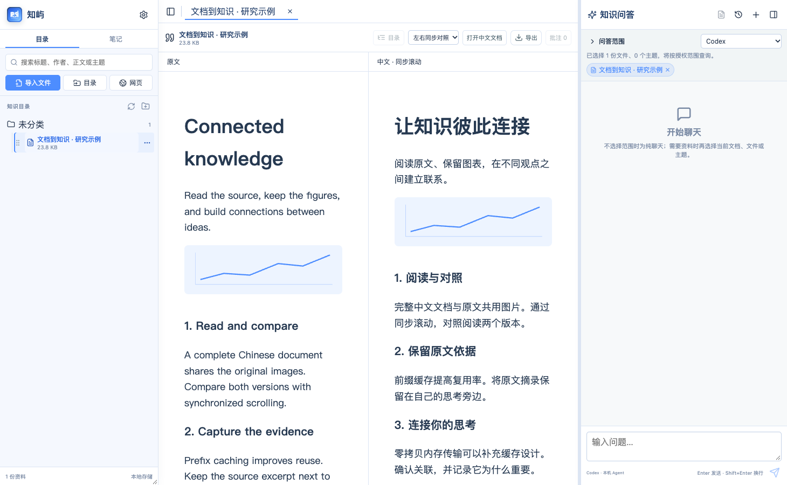
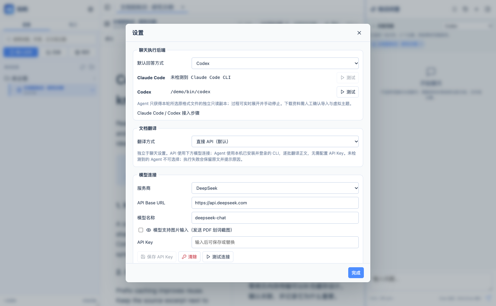
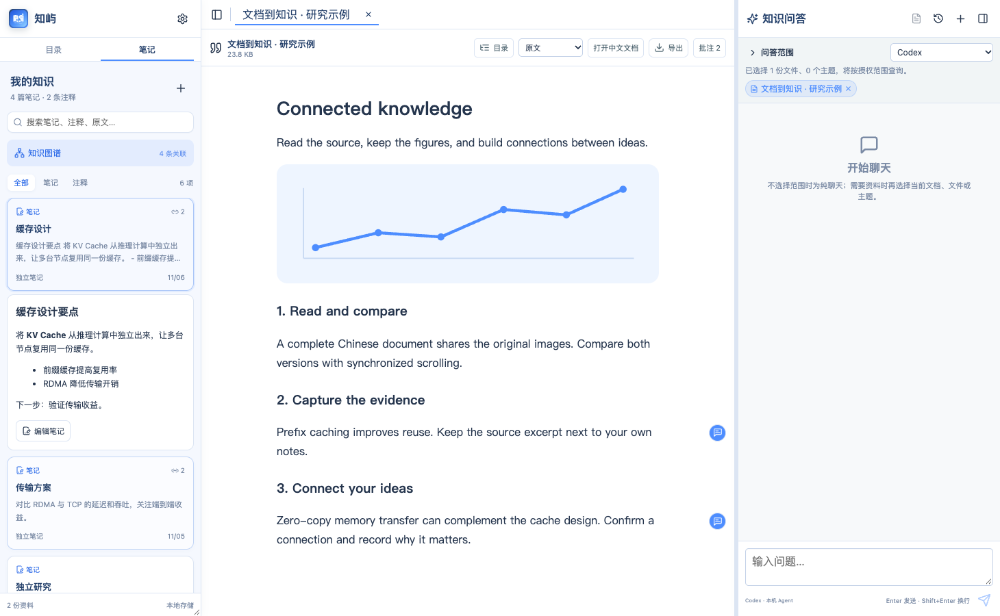
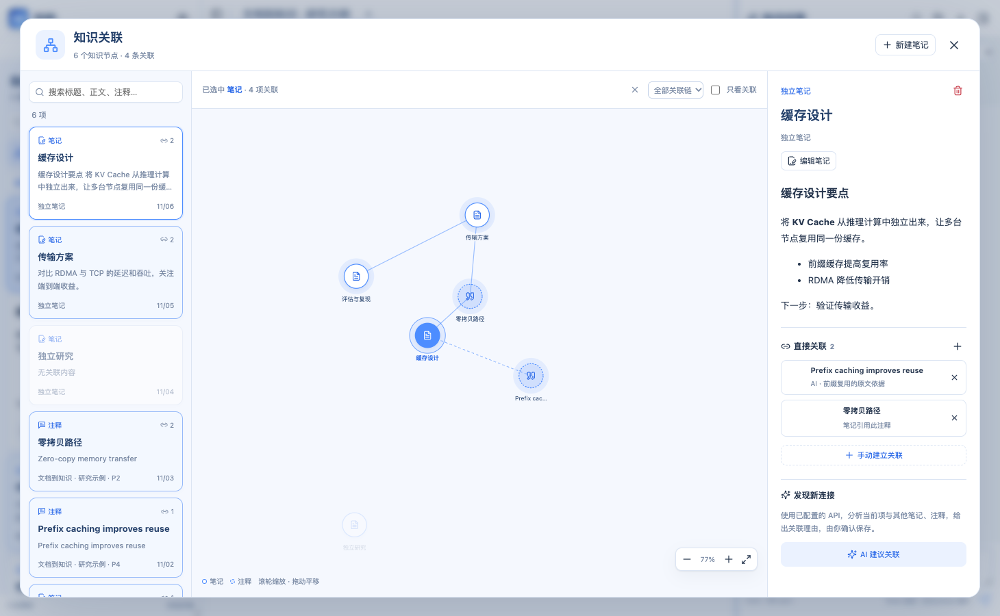

# 知屿 KnowledgeMaster

[简体中文](README.md) | [English](README.en.md)

> 面向科研论文学习的本地优先知识工作台，Tauri 版本同时面向 macOS 与 Windows。

知屿把“收集论文 → 精读与批注 → 研究笔记 → 跨文档问答 → 沉淀理解”放在一个桌面应用中。资料和元数据默认留在用户自己的磁盘；AI 只在用户发起请求时访问明确授权的范围。

> v0.3.0 包含全文翻译、笔记图谱和天蓝主题。macOS Apple Silicon 提供解压即用 ZIP，Windows x64 提供免安装 EXE / ZIP；请从 [Releases](https://github.com/hkcao/KnowledgeMaster/releases) 选择对应平台。

## 界面示意

以下为当前界面的示例资料截图；译文为演示内容，不含私人文档或笔记。

### 保留图片的双语阅读

导入时可选择全文翻译为中文，也可在已有文档中点击“翻译全文”。原文与独立中文文档共用图片，阅读器支持段落中英交替、左右对照和按段落同步滚动。



### 独立选择翻译方式

在“设置 → 文档翻译”中选择直接 API（默认）或已检测到的 Claude Code / Codex；聊天后端独立设置。中英文正文都可搜索，结果定位到原文，目录只列出一份文章。



### 点击笔记，只展开这一条

笔记与批注可直接搜索。点击卡片在列表内展开正文、摘录与编辑操作，再次点击收起；当前阅读文档保持不变，不会自动进入知识图谱。



### 通过独立入口查看知识图谱

只有点击“知识图谱”按钮才打开关联界面。选择笔记或批注可高亮全部关联链，也可只看直接关联；支持手动建立/解除关系，或让已配置的模型建议关联并说明理由，确认后保存。



## 开始使用

1. **导入资料**：选择文件、目录或网页；按需勾选中文翻译。扫描 PDF 可先在设置中下载本地 OCR 模型。
2. **阅读与记录**：阅读原文或双语对照，划词添加批注，将思考保存为 Markdown 笔记。
3. **搜索与展开**：切换到“笔记”，搜索标题、正文或摘录，点击一项查看完整内容。
4. **连接与问答**：通过“知识图谱”整理关联；打开 Agent 对话时，默认包含当前阅读文档，也可手动取消或增加其他文档/主题。

## 主要能力

### 论文资料管理

- 文件选择、目录递归、拖放和网址导入。
- 支持 PDF、HTML、Markdown、TXT、DOC、DOCX。
- 文件名和 SHA-256 双重去重，原件平铺保存。
- 论文展示名优先采用“一作 et al., 论文标题”。
- 层级虚拟主题；同一文档可归属多个主题。
- 导入后在本机推荐主题，用户确认后才建立关联。
- 文件名、主题和正文关键词检索，不使用向量数据库。
- 资料库目录可配置；放进 iCloud Drive、OneDrive 等同步目录时依赖系统同步。

### 阅读、批注与笔记

- PDF.js 连续阅读、可选文字层、触控板/滚轮缩放、书签和目录导航。
- HTML、Markdown、文本只读预览；Markdown 支持 GFM 与 LaTeX。
- 多标签阅读，左右侧栏隐藏/恢复不改变当前文档。
- PDF 与文本内容支持鼠标划词；选择完成后在选区旁显示 Ask AI、引用、高亮、划线和笔记。
- AI 选区上下文同时携带原文；开启多模态时携带选区截图。
- 批注入口位于对应正文旁的空白区域，点击后可查看和编辑。
- 总结笔记以 Markdown 文件保存，可关联多条原文批注。
- 笔记与注释以卡片展示，可直接搜索标题、正文、原文摘录及来源文档名；点击卡片仅在列表内展开这一条内容，可阅读、编辑或定位原文；知识图谱通过独立按钮打开。
- 知识图谱支持笔记与笔记、笔记与注释、注释与注释之间的手动关联，兼容已有注释引用。选中节点可高亮全部关联链或直接关联，支持搜索筛选、缩放与平移。
- 可使用已配置的 API 建议关联并给出理由，确认后保存；候选较多时分析最相关的 40 项，并显示本次分析范围。
- 支持导出原文和带批注版本。
- 导入文件、目录、拖放或网页时可选择全文翻译为中文，在设置中独立选择翻译方式（默认直接 API，也可选已检测到并登录的 Claude Code / Codex）；已有文档可点击“翻译全文”。原件保留，译文另存为可搜索的中文 HTML 文档，图片共用资料库的资源目录。中英文正文同时参与检索，结果统一定位原文；左侧目录只显示原文，不重复列出译文。删除原文后保留的译文仍可独立显示。
- 双语阅读支持“段落中英交替”和“左右同步对照”，按对应段落同步滚动。文字 PDF 保留页面图形和文字位置；扫描页保留扫描图并在下方显示 OCR 译文；DOCX 保留段落、表格和嵌入图片，复杂 Word 分页/浮动排版不保证完全一致，DOC 请先转为 DOCX/PDF。代码和公式保留原样。

### AI 与本地 Agent

- 直接 API 支持 DeepSeek、智谱 GLM 和自定义 OpenAI 兼容接口。
- API 模式可选“相关片段”或带文件工具的“自主检索”。
- 支持本机 Claude Code 与 Codex CLI，保留可折叠执行过程并允许手动终止。
- 右侧可同时选择多份文档或主题作为问答范围；Agent 会为该范围建立隔离的临时虚拟工作区。
- Agent 读取只读原始资料副本，可复用已有 PDF/OCR/解析缓存，不依赖预切分文本。
- 启用 Agent 或新建 Agent 对话时默认勾选当前阅读文档，随当前标签切换，可在问答范围或文档标签中取消。
- 没有引用、已选文档/主题或自动包含的当前文档时为纯聊天；直接 API 初始范围为空。
- Agent 下载资料先进入待确认区；用户确认文件后，再人工确认虚拟主题。
- 保存对话历史并增量生成 Markdown 摘要。

### 本地优先与安全

- 资料、主题、全文索引、批注、笔记和对话保存在用户选择的资料库。
- API Key 使用 macOS Keychain 或 Windows Credential Manager。
- 启动应用、打开设置和切换服务商不会读取 Key；发送请求或测试连接时才按需访问。
- Agent 只能写入隔离工作区；原始资料副本和解析缓存只读。
- 元数据使用带外键和索引的 SQLite；旧版 `knowledge.json` 首次启动时自动迁移并保留一份后续不再写入的备份。
- 前端不具有任意文件系统权限，文件操作统一由 Rust 命令校验。

## 平台与技术

| 项目 | macOS | Windows |
|---|---|---|
| 最低目标 | macOS 14+ | Windows 10/11 |
| WebView | 系统 WebKit | WebView2 |
| 凭据 | Keychain | Credential Manager |
| Agent 终止 | 终止进程 | `taskkill /T` 终止进程树 |
| 发布包 | 免安装 `.zip` / `.dmg` | 免安装 `.exe` / `.zip` / NSIS 安装版 `.exe` |

共享技术栈：

- Tauri 2
- React 19 + TypeScript + Vite
- Rust
- PDF.js
- React Markdown + GFM + KaTeX

不使用 Electron，不依赖云端业务服务，不引入 embedding 或向量数据库。

## 安装与首次使用

### Windows

1. 在 [GitHub Releases](https://github.com/hkcao/KnowledgeMaster/releases) 下载 `KnowledgeMaster-portable.exe`。这是免安装版本，放在任意普通目录后双击即可运行。
2. 如果希望自动创建开始菜单入口，也可以下载文件名以 `-setup.exe` 结尾的 NSIS 安装版。不要下载 macOS 的 `.dmg`。
3. 便携版依赖系统 WebView2。较新的 Windows 10/11 通常已经自带；如果程序无法打开，请先安装 Microsoft Edge WebView2 Runtime。安装版会在缺失时联网补充安装。
4. 未签名版本可能触发 Windows SmartScreen；请先确认文件来自本仓库的 Release，再选择“更多信息 → 仍要运行”。
5. 第一次启动后，在“设置”中选择资料库目录。需要多设备同步时，可以选择 OneDrive 内的目录，但不要让两台设备同时修改同一个资料库。
6. 直接 API 功能需要在设置中填写模型连接和 API Key，Key 按需读取并保存在 Windows Credential Manager。使用已登录的 Claude Code / Codex 翻译或聊天时不需要应用 API Key。

如果 Release 中暂时没有 Windows 安装程序，可以按下方“Windows 编译”从源码生成。

### macOS

从 [GitHub Releases](https://github.com/hkcao/KnowledgeMaster/releases) 下载 `KnowledgeMaster-0.3.0-macOS-arm64-portable.zip`，解压后直接打开应用。也可下载 `.dmg`，打开后把知屿拖入“应用程序”并启动。未经过 Apple 公证的版本首次打开时，需要在“系统设置 → 隐私与安全性”中确认允许打开。

### 本地 CPU OCR（v0.2.8 起）

在“设置 → 本地 PDF OCR · MinerU”点击“下载 OCR 模型与运行环境”。应用会下载独立 Python 环境、MinerU 4.0.12 和 Basic ONNX 模型，无需自行安装 Python 或配置显卡。模型约 0.8 GB，运行库和安装缓存另占空间；下载源可选自动、ModelScope 或 Hugging Face，可取消并重新尝试。

自动 OCR 默认开启。普通文字 PDF 优先直接提取；解析失败时尝试全文 OCR，页面文字不足时只识别相关页并保留原页码。未下载模型时，普通文字提取仍可使用；需要 OCR 的失败文件保留原位，在模型就绪后刷新目录重试。单个文档失败不会中断其他文件，目录中会列出失败明细。旧的空正文 PDF 索引也会在模型就绪后尝试恢复。

OCR 在独立本地进程中运行，识别阶段使用本地模型，不上传文档。模型、运行环境及按源文件哈希/引擎版本/页范围复用的 OCR 缓存保存在设置中显示的本机应用数据目录，不进入安装包或同步资料库；识别结果进入原有全文索引。关闭设置中的自动 OCR 可恢复为只做直接文字提取。CPU 速度取决于文档长度和版式，复杂公式/表格仍需核对原文。

使用 [MinerU](https://github.com/opendatalab/MinerU) 与 [uv](https://github.com/astral-sh/uv) 提供本地运行能力，分别适用其上游许可及模型许可；本项目自身仍使用 MIT 许可。

## 从源码编译

### Windows 编译

准备 Windows 10/11 x64 环境，并安装：

- [Node.js 22 LTS](https://nodejs.org/)。
- [Rust stable](https://www.rust-lang.org/tools/install)，使用默认的 `x86_64-pc-windows-msvc` 工具链。
- [Microsoft C++ Build Tools](https://visualstudio.microsoft.com/visual-cpp-build-tools/)，安装时勾选“使用 C++ 的桌面开发”和 Windows 10/11 SDK。
- Microsoft Edge WebView2 Runtime。较新的 Windows 10/11 通常已经自带；缺失时可从 [Microsoft WebView2](https://developer.microsoft.com/microsoft-edge/webview2/) 安装 Evergreen Runtime。

在 PowerShell 中执行：

```powershell
git clone https://github.com/hkcao/KnowledgeMaster.git
cd KnowledgeMaster
npm ci
npm test
cargo test --manifest-path src-tauri/Cargo.toml
npm run tauri dev
```

生成应用后，原始可执行文件位于 `src-tauri\target\release\knowledge-master.exe`。复制并改名即可得到免安装便携版：

```powershell
npm run tauri build -- --bundles nsis
Copy-Item src-tauri\target\release\knowledge-master.exe KnowledgeMaster-portable.exe
```

同一次构建也会生成 Windows NSIS 安装程序：

```powershell
Get-ChildItem src-tauri\target\release\bundle\nsis\*-setup.exe
```

Windows 包应在 Windows 上构建。仓库的 GitHub Actions 会在 Windows Runner 中同时验证便携版和安装版；推送 `v*` 标签时，两种 `.exe` 会自动附加到对应 GitHub Release。

### macOS 编译

需要 macOS 14+、Xcode Command Line Tools、Node.js 22 LTS 和 Rust stable：

```bash
git clone https://github.com/hkcao/KnowledgeMaster.git
cd KnowledgeMaster
npm ci
npm test
cargo test --manifest-path src-tauri/Cargo.toml
npm run tauri dev
```

生成 `.app` 和 `.dmg`：

```bash
npm run tauri build -- --bundles app,dmg
```

构建结果位于 `src-tauri/target/release/bundle/macos/` 与 `src-tauri/target/release/bundle/dmg/`。

macOS 与 Windows 的正式安装包应在各自系统上构建。仓库提供 `.github/workflows/tauri-ci.yml`，会在两种系统上分别运行前端测试、Rust 测试，并验证 macOS `.dmg`、Windows 便携版和 NSIS `.exe` 构建。

## 本地资料结构

```text
<资料库目录>/
├── knowledge.db                   # SQLite 元数据
├── knowledge.json.migrated-v8.bak # 仅旧版首次迁移时生成
├── index/assets/                  # HTML/Markdown 图片引用映射
└── source/
    ├── documents/                # 导入原件与独立中文文档
    ├── assets/                   # 原文与中文译文共用图片
    ├── downloads/pending/        # Agent 下载待确认
    ├── generated/                # agent-cache/ 解析缓存与 chunks/ 分块缓存
    ├── index/                    # 提取文本与 translations/ 译文对齐记录
    └── notes/                    # Markdown 笔记
```

macOS 与 Windows 使用相同的相对路径和 SQLite schema。资料库可随同步盘迁移，但不建议两台设备同时打开并修改同一个资料库。

当前源码会将 schema 1 资料库自动升级为 schema 2，增加笔记关联表；升级前请备份资料库，旧安装包无法打开升级后的库。

## Agent 接入

先在本机终端安装并登录对应 CLI，再在知屿设置中测试连接：

- Claude Code：应用查找 `claude`；Windows 同时识别 npm 生成的 `claude.cmd`。
- Codex：应用查找 `codex`；macOS 也识别 ChatGPT 应用内置 Codex，Windows 同时识别 `codex.cmd`。

退出知屿会终止由本次应用启动且仍在运行的 Agent 进程，不会退出用户在其他终端中独立运行的 Agent。

选择文档或主题后，应用会按授权范围创建独立的系统临时目录。Agent 只看到其中的资料副本、解析缓存和可写的生成/下载目录，不会获得资料库原始路径；问答范围发生变化时会切换到新的工作区和会话。

## 当前遗留功能

1. 尚未实现可自动召回的跨会话长期记忆。
2. 模型上下文压缩、缓存复用和 Token 性价比仍需优化。
3. 扫描 PDF、复杂表格、公式和 OCR 的解析与复用策略仍需优化。
4. 界面视觉细节和动效仍可继续提升。
5. Windows 已纳入本实现和 CI 构建目标，但仍需要在真实 Windows 设备上持续做触控板、输入法、WebView2 和 Agent CLI 兼容性验收。

### 优化顺序

1. **P0 · 上下文与缓存**：先度量候选片段、实际发送内容、缓存命中和摘要覆盖范围，再优化上下文去重、总 Token 预算和按需摘要。固定语料上的引用命中不能下降。
2. **P1 · 解析与 OCR**：仅在页面没有文本或文本密度过低时触发 OCR；解析缓存关联源文件哈希、提取器版本和语言配置，并以扫描页、双栏、表格和公式样例做回归测试。
3. **P2 · 跨会话记忆**：在不引入向量数据库的前提下，先用本地 SQLite 保存用户确认的结论、待办和来源，通过关键词、主题和时间过滤召回；记忆必须可查看、编辑、删除和关闭自动召回。
4. **持续项 · 界面与 Windows**：自动化优先覆盖输入法组合、弹窗层级、PDF 缩放/选区和 Agent 不可用回退；触控板、中文输入法、WebView2、PDF 清晰度和 `.cmd` Agent CLI 继续通过 Windows 真机验收。

以上是迭代顺序，不代表这些遗留功能已完成；每一阶段都应先补可复现测试和衡量基线，再修改实现。

## 许可证

本项目采用 [MIT License](LICENSE)。
